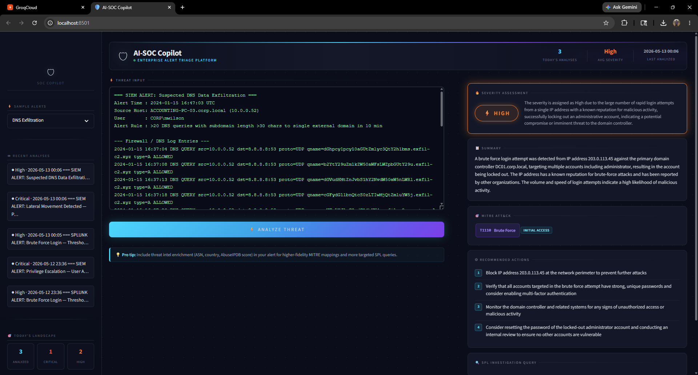
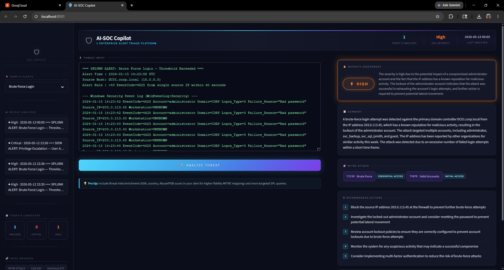
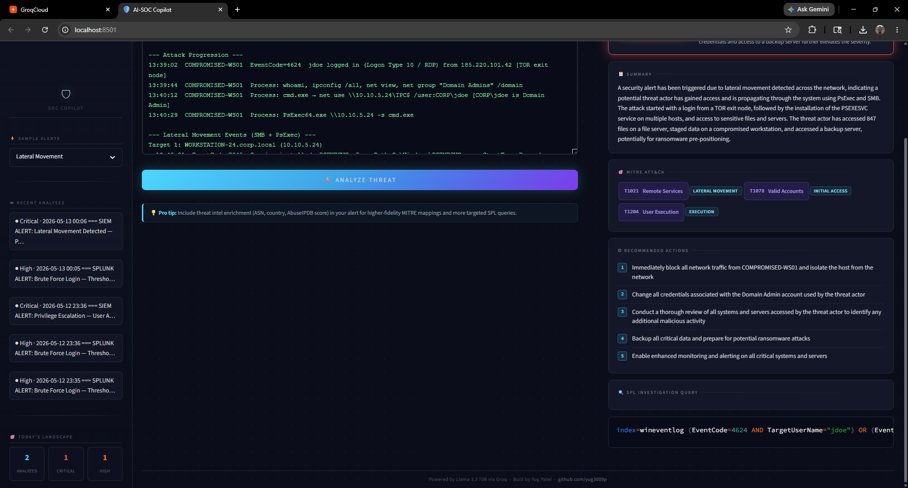
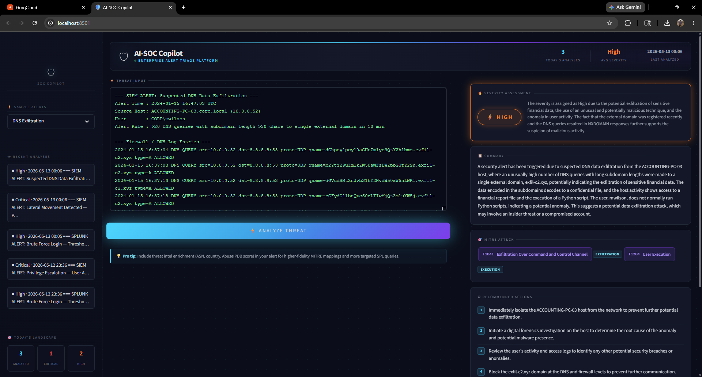

# 🛡️ AI-SOC Copilot

> AI-assisted security alert triage: paste a raw alert, get a structured first-pass analysis with severity, MITRE ATT&CK mapping, recommended actions and Splunk SPL hunt queries.


---

## Screenshots



*Dashboard view — the main interface with the alert input panel and structured analysis output.*



*Lateral movement analysis — AI triage of a Windows lateral movement alert with MITRE mapping and remediation steps.*



*DNS exfiltration analysis — detection of data exfiltration via DNS tunneling with severity rating and SPL queries.*



*Brute force analysis — credential brute force triage with blocked IP recommendations and Splunk investigation queries.*

---

## Why This Project

SOC analysts receive far more alerts than they can investigate in depth. Triage means manually cross-referencing event codes, looking up MITRE ATT&CK mappings, writing investigation queries and documenting findings: repetitive work that slows response.

This alert fatigue leads to:
- Critical threats buried under noise
- Analyst burnout and high turnover
- Slower mean-time-to-respond (MTTR)
- Inconsistent triage quality across skill levels

**AI-SOC Copilot** is a first-pass assistant for that work: paste a raw alert and get a structured analysis to review. The analyst still makes the call; the tool drafts the lookups, mappings and queries.

---

## Tech Stack

| Layer | Technology |
|---|---|
| UI | Streamlit |
| AI Engine | Llama 3.3 70B Versatile (Groq) |
| SDK | `groq` Python SDK |
| Config | `python-dotenv` |
| Language | Python 3.11+ |
| History | Local `analyses.json` |

**Speed:** Groq's LPU inference hardware delivers sub-second latency on the Llama 3.3 70B model.

---

## Setup

### 1. Clone the repository

```bash
git clone https://github.com/yug3009p/ai-soc-copilot.git
cd ai-soc-copilot
```

### 2. Create and activate a virtual environment

```bash
# Windows
python -m venv venv
venv\Scripts\activate

# macOS / Linux
python -m venv venv
source venv/bin/activate
```

### 3. Install dependencies

```bash
pip install -r requirements.txt
```

### 4. Configure your API key

```bash
cp .env.example .env
```

Open `.env` and add your [Groq API key](https://console.groq.com/keys):

```
GROQ_API_KEY=gsk_...
```

### 5. Run the app

```bash
streamlit run app.py
```

The app opens at `http://localhost:8501`.

---

## Example Usage

**Input alert** (paste into the text area):

```
2024-01-15 14:23:42 EventCode=4625 Account=administrator Domain=CORP
Failure_Reason="Bad password" Source_IP=203.0.113.45
[50 similar events in 16 seconds]
2024-01-15 14:23:58 EventCode=4740 Account=administrator (ACCOUNT LOCKED OUT)
```

**AI output** (illustrative; LLM responses vary between runs):

| Field | Result |
|---|---|
| **Severity** | 🔴 Critical |
| **Summary** | An external IP (203.0.113.45) launched a credential brute-force attack against the domain controller, targeting the built-in administrator account. 50 failed logon attempts in 16 seconds triggered an account lockout. |
| **MITRE** | T1110.001 — Brute Force: Password Guessing (Credential Access) |
| **Actions** | Block 203.0.113.45 at perimeter firewall; investigate for successful logons; check all locked accounts; review DC event logs for EventCode=4624 post-lockout |
| **SPL Query** | `index=wineventlog EventCode=4625 src_ip=203.0.113.45 \| timechart span=1s count` |

---

## Evaluation

There is no formal evaluation yet. LLM output can be wrong, so treat every result as a draft for an analyst to verify. A labeled evaluation set that measures severity and ATT&CK-mapping accuracy is on the roadmap.

---

## Project Structure

```
ai-soc-copilot/
├── app.py               # Main Streamlit application
├── requirements.txt     # Python dependencies
├── .env.example         # API key template
├── .gitignore
├── LICENSE
├── README.md
├── screenshots/
└── sample_alerts/
    ├── brute_force_login.txt
    ├── dns_exfiltration.txt
    ├── privilege_escalation.txt
    └── lateral_movement.txt
```

---

## License

MIT License — see [LICENSE](LICENSE) for details.

---

## Author

**Yug Mukesh Patel**

[](https://www.linkedin.com/in/yugpatel9409/)
